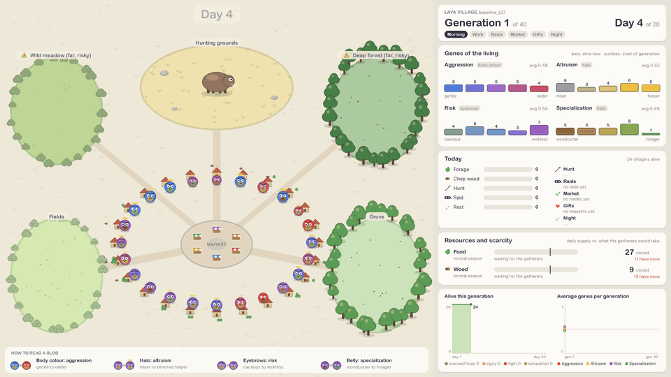
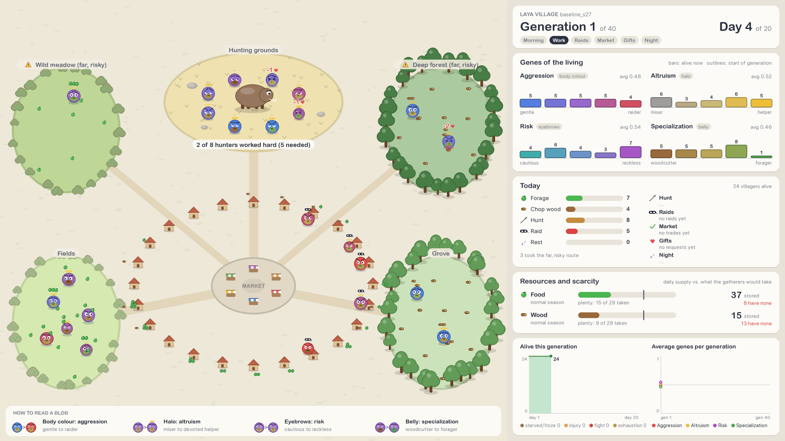
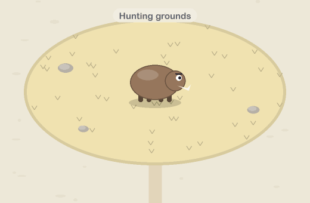
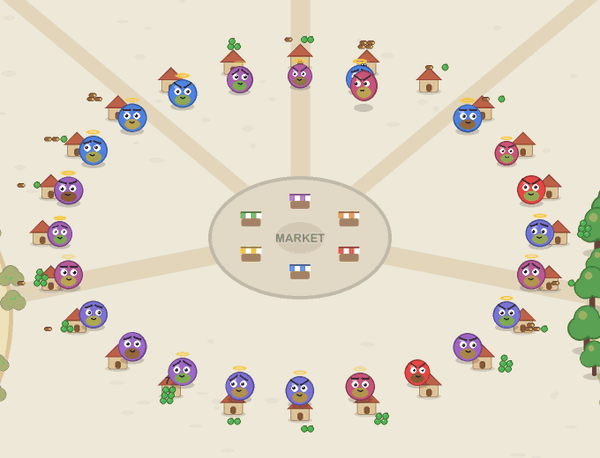
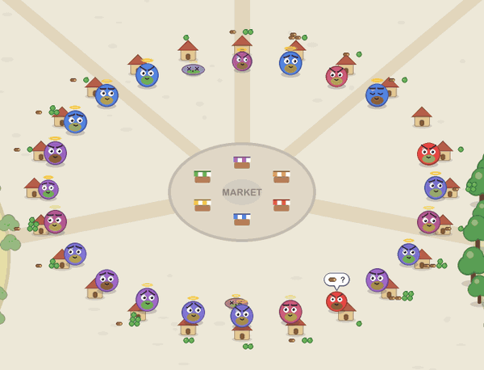
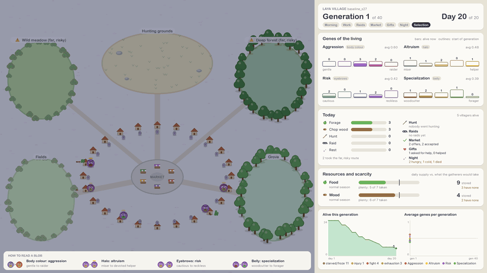
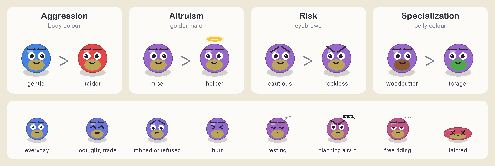

# Laya Village

<p align="center">
  
</p>

**An evolutionary economy simulation in which every decision is made by a language model.** A village of agents
forages, cuts wood, hunts together, robs, trades and shares to survive. Each villager's genes become the persona
that the [Laya](#decision-engines) typed-decision model reasons with. The survivors of each season breed, and we
watch which personalities evolve.

The full specification, with every rule, prompt and design decision, is in
[SIMULATION_DESIGN.md](SIMULATION_DESIGN.md).

## How the village works

A village of `N` agents lives through a season of `D` days. Every night each agent must eat 1 food and burn 1
wood, or lose health; at zero health it dies. Each day runs six phases:

| phase                     | what happens                                                                                                                      |
| ------------------------- | --------------------------------------------------------------------------------------------------------------------------------- |
| **Morning**         | each agent picks one activity: forage, chop wood, join the group hunt, raid someone, or rest                                      |
| **Work**            | gatherers collect from nearby fields and forests (safe) or far ones (richer, but they can get injured); crowded places yield less |
| **Hunt**            | a public-goods game: the hunt succeeds only if enough hunters work hard, but free riders get the same share                       |
| **Raids**           | a raider visits its victim, who fights back or yields half of their stock                                                         |
| **Market**          | an agent who lacks food or wood makes a generous, fair or greedy offer to a partner, who accepts or refuses                       |
| **Gifts and night** | agents with nothing ask neighbours with plenty for help; then everyone eats, burns wood and heals or suffers                      |

Four genes shape the agents. **Aggression**, **altruism** and **risk tolerance** act only through the persona
sentences in the prompts. **Specialization** also changes gathering yields (woodcutter vs. forager), which rewards
trade. At the end of the season the survivors are selected, crossed over and mutated into the next generation.

What we look for: hawk–dove equilibria in raiding, collapse or survival of cooperation in the hunt, division of labour
sustained by trade, reciprocity, and inequality ([§8.4](SIMULATION_DESIGN.md#84-emergence-indicators-what-would-count-as-a-result)).

## Quick start

Requirements: Python 3.12+ (developed on 3.14) and, for the Laya engine, an Apple silicon Mac.

```bash
python3 -m venv .venv && source .venv/bin/activate
pip install numpy matplotlib pyyaml pygame-ce laya-mlx
brew install ffmpeg            # only needed to render videos
```

Every command runs from the repository root:

```bash
# Smoke test: 2 generations of 3 days with a random "mock" brain
python src/main.py run --config configs/baseline.yaml --brain mock --generations 2 --days 3

# Fast run with the analytic policy engine, watched live while it runs
python src/main.py run --config configs/policy.yaml --live

# The real thing: every decision by Laya (about an hour on an M3 Pro)
python src/main.py run --config configs/baseline.yaml --seed 0

# Replay a run in the visualizer, or render it as a video
python src/main.py watch runs/baseline_s0
python src/main.py render runs/baseline_s0 --gens 1,last --days 1-6

# Redraw the analysis plots, and check that each decision responds to its gene (experiment E0)
python src/main.py plot runs/baseline_s0
python src/main.py calibrate --config configs/baseline.yaml
```

## The visualizer

A Primer-style animation of everything that happens in the village, with live charts. It can follow a simulation
while it runs (`run --live`, or `watch` on a run in progress), replay a finished run (`watch`), or render an MP4
from the saved events (`render`).



Each blob walks to its work every day. It picks up the food and wood lying in the fields and forests, carries its
haul home and stores it in the pile behind its hut. Crowded fields run bare and far places hurt the reckless.
Hunters circle the prey, raiders call at their victim's door, traders meet at the market stalls, gifts fly between
homes with hearts, and at night the campfires light up and the dead leave a gravestone.

<table>
  <tr>
    <td width="50%"><br>
      <b>The hunt.</b> Hard workers lunge at the prey and pay 1 health; free riders hang back. Here 5 of 6
      worked hard, the hunt succeeds, and every hunter gets 4 food.</td>
    <td width="50%"><br>
      <b>Raids and the market.</b> Victims fight back (dust cloud) or yield (white flag), and the loot flies to the
      winner. At the stalls a bubble shows the offer and the partner answers ✓ or ✗.</td>
  </tr>
  <tr>
    <td width="50%"><br>
      <b>Night.</b> Every villager eats 1 food and burns 1 wood. Those who lack either lose health; the ones who
      reach zero rise as ghosts.</td>
    <td width="50%"><br>
      <b>A new generation.</b> The survivors become the parents: each splits into children who inherit its genes,
      and the gene charts jump to the new population.</td>
  </tr>
</table>

<sub>All media come from the Laya run , generation 1 (random genes) and the hand-over to generation 2.</sub>

### How to read a blob



The body colour shows aggression by default; keys `1`–`4` (or `--color-by`) switch it to any gene. Blobs shrink as
they lose health, and their faces show what just happened to them.

### The dashboard

- **Header**: generation, day and the current phase.
- **Genes of the living**: how many living agents sit at each gene level (the five persona levels). Outlines show the
  start of the generation, so you can see selection as agents die.
- **Today**: how many forage, chop wood, hunt, raid or rest, plus the results of the hunt, raids, trades, gifts and
  the night.
- **Resources and scarcity**: the season, the gatherers' demand against the daily supply ("crowded: yields cut to
  71%"), the stored total, and how many villagers have none.
- **Charts**: villagers alive over the generation, with deaths by cause, and the average genes across generations.

### Controls

| key                     | action                                                                    |
| ----------------------- | ------------------------------------------------------------------------- |
| `space`               | pause / resume                                                            |
| `+` `-`             | faster / slower                                                           |
| `N` / `G` / `L`   | skip to the next day / the next generation / the latest day of a live run |
| `1` `2` `3` `4` | body colour: aggression, altruism, risk, specialization                   |
| `F`                   | full screen (the window can also be resized)                              |
| `H`                   | help                                                                      |
| `Q` `esc`           | quit                                                                      |

Hover over a blob to see its genes, health, stock and plan for the day.

Viewer options: `--speed`, `--color-by`, `--size` (initial window size, or the video size) and `--ssaa`
(supersampling, 1 is faster). `render` also takes `--gens` (1-based, e.g. `1,10-12,last` or `all`), `--days`
(e.g. `1-20` or `all`), `--fps` and `--out` (default `<run>/village.mp4`). A day lasts about 7–16 seconds at speed 1
(busy days take longer), so pick generations and days for long runs.

## Decision engines

| `brain.kind` | engine                                                                                                                                                                                                                                                                               | use                                     |
| -------------- | ------------------------------------------------------------------------------------------------------------------------------------------------------------------------------------------------------------------------------------------------------------------------------------ | --------------------------------------- |
| `laya`       | [Laya](SIMULATION_DESIGN.md#1-the-decision-engine-laya) (`laya-mlx`, checkpoint `aac6fef/laya-mlx`), a 421M-parameter typed-decision model. It gets the persona, the situation and annotated options, and returns a probability for each option; the simulation samples from them | the experiment                          |
| `policy`     | an analytic conditional logit over the same information ([§6.7](SIMULATION_DESIGN.md#67-alternative-engine-analytic-policies-policiespy)), with weights in `configs/policy_weights.yaml`                                                                                           | reference model; fast multi-seed sweeps |
| `mock`       | uniform random choices                                                                                                                                                                                                                                                               | smoke tests                             |

## Configurations

| file                         | engine | village                                                                                            |
| ---------------------------- | ------ | -------------------------------------------------------------------------------------------------- |
| `configs/baseline.yaml`    | Laya   | 24 agents, 20 days, 40 generations                                                                 |
| `configs/policy.yaml`      | policy | 50 agents, 100 days, 40 generations                                                                |
| `configs/policy_hard.yaml` | policy | harsher: scarcer supply, costlier injuries and fights, about half the village dies each generation |

`--seed`, `--generations`, `--days` and `--brain` override the file. Runs are written to `runs/<run_name>_s<seed>/`
(not tracked by git):

| file                | content                                                                                                              |
| ------------------- | -------------------------------------------------------------------------------------------------------------------- |
| `events.jsonl`    | every event of the run: decisions, gathering, hunts, raids, trades, gifts, nights, deaths; the visualizer reads this |
| `decisions.jsonl` | the exact state and questions sent to the engine for each decision                                                   |
| `generations.csv` | per-generation metrics: gene means, survival, behaviour rates, inequality                                            |
| `agents.csv`      | per-agent genes, survival and behaviour                                                                              |
| `plots/`          | gene trajectories, behaviour rates, survival, inequality, specialization                                             |

## Repository layout

```
configs/              run configurations and policy weights
src/main.py           command line: run, watch, render, plot, calibrate
src/simulation.py     generation loop
src/phases.py         the day cycle
src/prompts.py        Laya prompt catalogue
src/policies.py       analytic policy engine
src/brain.py          decision engines and sampling
src/evolution.py      fitness, selection, crossover, mutation
src/logEvents.py      event log and CSV output
src/metrics.py        per-generation metrics
src/plots.py          analysis plots
src/calibrate.py      E0: does each decision respond to its gene?
src/viewer/           the village visualizer (pygame-ce)
SIMULATION_DESIGN.md  full specification
poc.ipynb             first experiments with the Laya API
```
