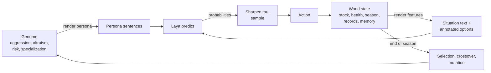
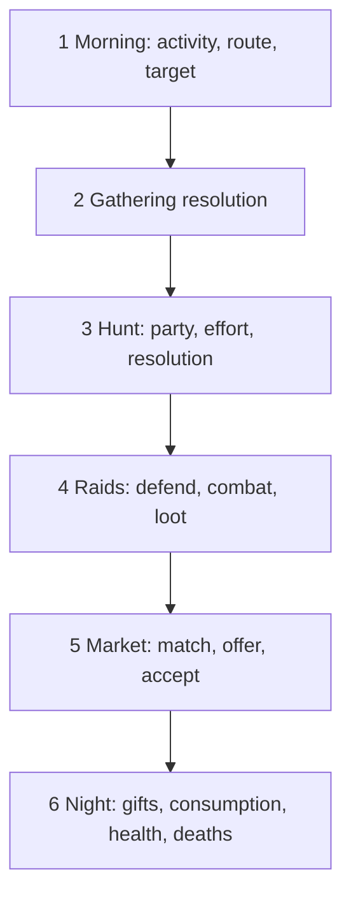

# Laya Village — Evolutionary Economy Simulation

**Every decision is made by the Laya typed-decision model; genes shape the persona Laya reasons with; survivors breed.**

This document is a complete implementation specification. It is written so that an engineer with no prior context can build the simulation from it. Wherever a design decision had to be made, it has been made and the rationale is recorded (Section 11). Where the design depends on how the Laya model actually behaves, the behaviour was **measured** on this machine before writing (Appendix A) and the design follows the measurements.

---

## Table of contents

0. [Purpose and one-paragraph summary](#0-purpose-and-one-paragraph-summary)
1. [The decision engine: Laya](#1-the-decision-engine-laya)
2. [Glossary and notation](#2-glossary-and-notation)
3. [World model](#3-world-model)
4. [Genome](#4-genome)
5. [The day cycle](#5-the-day-cycle)
6. [Decision engine integration](#6-decision-engine-integration)
7. [Evolution](#7-evolution)
8. [Logging, metrics and analysis](#8-logging-metrics-and-analysis)
9. [Experiments](#9-experiments)
10. [Implementation plan](#10-implementation-plan)
11. [Design decisions and alternatives considered](#11-design-decisions-and-alternatives-considered)

- [Appendix A — Measured Laya behaviour](#appendix-a--measured-laya-behaviour)
- [Appendix B — Full day-loop pseudocode](#appendix-b--full-day-loop-pseudocode)
- [Appendix C — Worked prompt example](#appendix-c--worked-prompt-example)
- [Appendix D — Default configuration file](#appendix-d--default-configuration-file)

---

## 0. Purpose and one-paragraph summary

A village of `N = 24` agents lives through a season of `D = 20` days. Each night an agent must consume **1 food and 1 wood** or lose health; at `health ≤ 0` it dies. During the day each agent chooses **one** activity: forage for food, cut wood, join a **group hunt** (an n-player threshold public-goods game: it only succeeds if enough hunters actually work hard, and free-riders get the same payout), **raid** another villager, or rest. Afterwards there is a **market** (a one-shot ultimatum bargaining game between an agent who lacks a resource and one who has spare) and a **night** phase where agents with surplus may **gift** to those who would otherwise go without. Every one of these choices — what to do, where to gather, whom to rob, whether to fight back, how much effort to put in the hunt, what to offer, whether to accept, whether to give — is made by calling the **Laya** model with (a) a short persona derived from the agent's **genes**, (b) a short description of the situation, and (c) a typed question whose options are annotated by the environment. Laya returns a probability distribution; the simulation samples the action from it. At the end of the season the **survivors** are selected, crossed and mutated to form the next generation. We record gene trajectories and behaviour rates over `G = 40` generations and look for emergent phenomena: hawk–dove equilibria in raiding, collapse or maintenance of cooperation in the hunt, division of labour between foragers and woodcutters sustained by trade, reciprocity, and inequality.



---

## 1. The decision engine: Laya

### 1.1 What Laya is

Laya (`laya-mlx` package, checkpoint `aac6fef/laya-mlx`, 421M-parameter ModernBERT encoder + decision heads) answers **typed questions** about a **state** in a single forward pass. It does **not** generate text. It supports three question types:

| type       | returns                                | used for                              |
| ---------- | -------------------------------------- | ------------------------------------- |
| `choice` | probability over named options         | most decisions                        |
| `noul`   | `P(true)` for a proposition          | yes/no decisions (gift, accept trade) |
| `score`  | probability over ordered rubric levels | not used (see §11)                   |

API (already used in [poc.ipynb](poc.ipynb)):

```python
import laya_mlx as laya
agent = laya.load("aac6fef/laya-mlx", dtype="float16", device="gpu", batch_size=8)
out = agent.predict(state_text, {
    "act": {"type": "choice", "instructions": "Choose what to do today.",
            "criteria": {"gather_food": "Forage alone. ...", "raid": "Rob another villager. ..."}},
    "gift": {"type": "noul", "instructions": "Do you give Agent 3 one food?"},
})
out["answers"]["act"]["probabilities"]   # {"gather_food": 0.62, "raid": 0.07, ...}
out["answers"]["gift"]["noul"]           # 0.72
```

Hard limits of the checkpoint (from `rl_agent_config.json` and `laya_mlx/common.py`):

- Total sequence `max_len = 512` tokens: `[CLS] <type> instructions [SEP] [MASK] opt0 [MASK] opt1 … [SEP] state [SEP]`. The question part (instructions + options) is capped at `head_max_len = 192` tokens; **each option text is truncated to 48 tokens**; the state gets the remaining room and is **truncated from the right**. Put the most important text (persona) **first** in the state.
- Calibration temperatures are applied per option-count bucket: `choice:2 = 1.91`, `choice:3-5 = 1.76`, `choice:6-10 = 1.00`, `noul = 1.98`. Temperatures > 1 **flatten** distributions, so 2–5-option questions come back close to uniform unless the evidence is strong. The `choice:11+` bucket is clamped (the checkpoint ships a nonsensical value) — **never offer more than 10 options**. Loading emits a `RuntimeWarning` about this clamp; filter it.
- Inference is **deterministic** for identical inputs (verified: identical probabilities on repeated calls).
- Measured latency on Apple M3 Pro, FP16: **≈55 ms** for a 1-question call, **≈130 ms** for 3 questions, **≈490 ms** for 16 questions (all questions in one call share one state).

### 1.2 What Laya is *not* — and how the design copes

The probes in Appendix A establish three facts that drive the whole prompt design:

1. **Laya does not do arithmetic or economic reasoning.** Changing `"You have 0 food"` to `"You have 5 food"` in the state barely moves the activity distribution. Telling it a trade "leaves you enough for tonight" versus "you will lose 2 health" barely moves acceptance.
   **Consequence:** the *environment* computes every consequence and writes the verdict as plain words **inside the option text** (`"URGENT: you have no wood for tonight."`, `"You already have enough food."`, `"Easy target, but a friend."`). Laya's job is to pick among *pre-digested* options in the light of a persona. This is exactly the pattern of the package's own Snake demo (planner features → Laya chooses).
2. **Laya responds to persona when it is an identity statement, placed first, and few in number.** `"You are a feared raider who lives by taking from others."` raises `P(raid)` from ≈0.13 to ≈0.74. Numeric personas (`"Aggression: 10/10"`) do nothing. Stacking four trait sentences dilutes and sometimes inverts the effect.
   **Consequence:** each decision renders **only the genes relevant to that decision** (the *decision-relevance matrix*, §4.4), as the first sentence(s) of the state.
3. **Only the extreme persona levels move probabilities strongly; middle levels are nearly flat.** And because of the calibration temperatures, even a "strong" response is often 0.7 rather than 0.95.
   **Consequence:** actions are **sampled** from the distribution after **sharpening** with a temperature `τ = 0.5` (§6.2). Sampling turns a flat middle into stochastic baseline behaviour and the extremes into clear deviations, which is all selection needs. Argmax is kept as an experimental mode.

The architecture is therefore **Planner → Persona → Chooser**: rules compute features and verdicts, genes render a persona, Laya chooses, the simulation samples.

---

## 2. Glossary and notation

| symbol                                          | meaning                                                                                     |
| ----------------------------------------------- | ------------------------------------------------------------------------------------------- |
| `N`                                           | population size (default 24)                                                                |
| `D`                                           | days per generation/season (default 20)                                                     |
| `G`                                           | number of generations (default 40)                                                          |
| `r ∈ {food, wood}`                           | a resource;`other(food) = wood` and vice versa                                            |
| `stock[a][r]`                                 | integer units of`r` held by agent `a`                                                   |
| `health[a]`                                   | integer in`[0, 10]`                                                                       |
| `g[a] = (g_agg, g_alt, g_risk, g_spec)`       | genome, each gene a float in`[0, 1]`                                                      |
| `level(g) = min(4, floor(5·g))`              | persona level 0–4                                                                          |
| `τ`                                          | decision sharpening temperature (default 0.5)                                               |
| `rng`                                         | the single seeded NumPy`Generator` used for all randomness                                |
| `wealth[a] = stock[a][food] + stock[a][wood]` |                                                                                             |
| **public record**                         | per-agent counters visible to everyone:`raids`, `gifts`, `contributed`, `free_rode` |
| **memory**                                | per-agent private list of dated events involving specific other agents                      |

Rounding rule used throughout: **stochastic rounding** `sround(x) = floor(x) + Bernoulli(x − floor(x))`, drawn from `rng`.

---

## 3. World model

### 3.1 Entities

- **Village**: the single arena. Holds the list of agents, the day counter, the season multipliers, yesterday's summary, and the event log.
- **Agent**: `id` (int, unique within a run), `genome`, `health`, `stock`, `alive`, `days_alive`, `record` (public), `memory` (private), `today` (scratch: chosen activity, route, target, whether traded/gifted today).
- **Season**: multipliers `season[r] ∈ {0.5 (scarce), 1.0 (normal), 1.5 (plentiful)}` per resource per day, set by a schedule in the config (baseline: `1.0/1.0` every day).

### 3.2 Parameters (defaults)

| parameter                  | default                | meaning                                                                 |
| -------------------------- | ---------------------- | ----------------------------------------------------------------------- |
| `N`                      | 24                     | agents per generation                                                   |
| `D`                      | 20                     | days per generation                                                     |
| `G`                      | 40                     | generations                                                             |
| `health_max`             | 10                     |                                                                         |
| `health_init`            | 10                     | health of every new agent                                               |
| `stock_init`             | `{food: 2, wood: 2}` | stock of every new agent                                                |
| `need`                   | `{food: 1, wood: 1}` | nightly consumption                                                     |
| `miss_penalty`           | 2                      | health lost per missing unit at night                                   |
| `regen`                  | 1                      | health gained at night if both needs met                                |
| `base_yield`             | 2.0                    | units gathered per day on the near route before multipliers             |
| `far_multiplier`         | 1.5                    | yield multiplier on the far route                                       |
| `far_injury_p`           | 0.25                   | probability of injury on the far route                                  |
| `far_injury_dmg`         | 2                      | health lost on injury                                                   |
| `supply_per_capita`      | 1.2                    | daily village supply of each resource per living agent (congestion cap) |
| `hunt_min_party`         | 2                      | fewer hunters → hunt cancelled                                         |
| `hunt_threshold_frac`    | 0.6                    | hunt succeeds iff`contributors ≥ ceil(0.6 · party)`                 |
| `hunt_effort_cost`       | 1                      | health cost of contributing                                             |
| `hunt_payout`            | 4                      | food per hunter on success                                              |
| `hunt_supply_per_capita` | 2.0                    | total hunt food capped at`2.0 · N_alive`                             |
| `hunt_cancel_food`       | 1                      | food each would-be hunter gets if the hunt is cancelled                 |
| `rest_regen`             | 2                      | health gained by resting                                                |
| `loot_frac`              | 0.5                    | fraction of the loser's/victim's stock taken                            |
| `fight_dmg`              | 2                      | health lost by the loser of a fight                                     |
| `trade_spare_min`        | 2                      | a partner must hold`≥ 2` of a resource to sell 1                     |
| `gift_spare_min`         | 3                      | a donor must hold`≥ 3` of a resource to be asked                     |
| `memory_days`            | 5                      | events older than this are not rendered                                 |
| `memory_render`          | 2                      | at most this many memory events rendered per prompt                     |
| `rep_threshold`          | 2                      | counter value at which a public label applies                           |
| `tau`                    | 0.5                    | sharpening temperature (0 = argmax)                                     |
| `elites`                 | 2                      | survivors copied unchanged                                              |
| `tournament_k`           | 3                      |                                                                         |
| `p_mut`                  | 0.15                   | per-gene mutation probability                                           |
| `sigma_mut`              | 0.1                    | mutation standard deviation                                             |
| `wealth_ref`             | 10                     | wealth that saturates the fitness bonus                                 |
| `seed`                   | 0                      |                                                                         |

### 3.3 Agent state variables

```python
@dataclass
class Agent:
    id: int
    genome: Genome                 # 4 floats in [0,1]
    health: int = 10
    stock: dict = {"food": 2, "wood": 2}
    alive: bool = True
    days_alive: int = 0
    record: Record                 # public: raids, gifts, contributed, free_rode  (ints)
    memory: list[MemoryEvent]      # private
    # per-day scratch, reset every morning:
    activity: str | None; route: str | None; target: int | None
    traded_today: bool; asked_gift_today: set[str]   # resources already asked for tonight
```

`MemoryEvent = (day, other_id, kind, resource | None)` with `kind ∈ {robbed_me, i_robbed, gave_me, i_gave, traded_fair, traded_generous_to_me, traded_greedy_to_me, refused_me, i_refused, shirked_in_my_hunt, worked_in_my_hunt}`.

### 3.4 Public record and labels

Counters are cumulative **within a generation** and reset for the new population. They are rendered into text only via labels, never as numbers:

| condition                                                      | label                                                     |
| -------------------------------------------------------------- | --------------------------------------------------------- |
| `raids ≥ rep_threshold`                                     | `"a known raider"`                                      |
| `gifts ≥ rep_threshold`                                     | `"known to be generous"`                                |
| `free_rode ≥ rep_threshold`                                 | `"a known shirker"`                                     |
| `contributed ≥ rep_threshold and free_rode < rep_threshold` | `"a reliable hunter"`                                   |
| none                                                           | `"nothing notable is known"` (omitted in compact lists) |

Additional derived labels (used in option texts):

| quantity                                                                  | label                                                                                                                                                                                                                   |
| ------------------------------------------------------------------------- | ----------------------------------------------------------------------------------------------------------------------------------------------------------------------------------------------------------------------- |
| `wealth ≥ 8` / `≤ 3` / else                                         | `"rich"` / `"poor"` / `"of average wealth"`                                                                                                                                                                       |
| `health ≥ 7` / `≤ 3` / else                                         | `"strong"` / `"weak"` / `"of average strength"`                                                                                                                                                                   |
| `stock[r] == 0` / `1–2` / `≥ 3`                                   | `"URGENT: you have no {r} for tonight."` / `"You have little {r}."` / `"You already have enough {r}."`                                                                                                            |
| `health ≤ 3` / `4–6` / `≥ 7`                                     | `"Your health is dangerously low."` / `"Your health is low."` / `""`                                                                                                                                              |
| relation (most recent memory event with that agent within`memory_days`) | `"Robbed you on day 5."`, `"Gave you food on day 6."`, `"Traded fairly with you on day 4."`, `"Refused your offer on day 7."`, `"Held back in your hunt on day 6."`, `"Worked hard in your hunt on day 6."` |

---

## 4. Genome

### 4.1 Genes

| gene           | symbol     | range     | what it influences                                                                                                                |
| -------------- | ---------- | --------- | --------------------------------------------------------------------------------------------------------------------------------- |
| aggression     | `g_agg`  | `[0,1]` | persona for activity and target choice (raiding)                                                                                  |
| altruism       | `g_alt`  | `[0,1]` | persona for hunt effort, trade offer/acceptance, gifts                                                                            |
| risk tolerance | `g_risk` | `[0,1]` | persona for activity, route, and defence                                                                                          |
| specialization | `g_spec` | `[0,1]` | **mechanical**: gathering yields (0 = pure woodcutter, 1 = pure forager); also a capability sentence in the activity prompt |

Only `g_spec` has a direct mechanical effect. The three behavioural genes act **exclusively through the prompt**; if Laya were replaced by a coin, they would be neutral (this is the control experiment E7).

### 4.2 Gene → persona sentence

`level = min(4, floor(5 · g))`. The sentence tables below are the defaults; **they must pass the calibration procedure in §9 E0 before a production run**, and may be re-worded if they fail. Measured responses are in Appendix A.

**Aggression** (identity style):

| level | sentence                                                                       |
| ----- | ------------------------------------------------------------------------------ |
| 0     | You are a gentle farmer who abhors violence and never takes what is not yours. |
| 1     | You are a quiet villager who dislikes conflict.                                |
| 2     | You are an ordinary villager who takes care of your own.                       |
| 3     | You are a tough brawler who takes what you need.                               |
| 4     | You are a feared raider who lives by taking from others.                       |

**Altruism** (identity style):

| level | sentence                                                       |
| ----- | -------------------------------------------------------------- |
| 0     | You are a miser who never shares anything with anyone.         |
| 1     | You are a self-reliant villager who seldom helps others.       |
| 2     | You are an ordinary villager who helps when it is convenient.  |
| 3     | You are a kind neighbour who likes to help others.             |
| 4     | You are a devoted helper who always shares with those in need. |

**Risk tolerance**:

| level | sentence                                             |
| ----- | ---------------------------------------------------- |
| 0     | You are extremely cautious and avoid every risk.     |
| 1     | You prefer safe, predictable choices.                |
| 2     | You take moderate risks when the reward is worth it. |
| 3     | You are bold and enjoy taking chances.               |
| 4     | You are a reckless gambler who loves danger.         |

**Specialization** (capability statement; avoid words like "hopeless", which Laya reads as desperation and which raises raiding):

| level | sentence                                          |
| ----- | ------------------------------------------------- |
| 0     | You are a master woodcutter but a poor forager.   |
| 1     | You are a good woodcutter and a mediocre forager. |
| 2     | You are equally able at foraging and woodcutting. |
| 3     | You are a good forager and a mediocre woodcutter. |
| 4     | You are a master forager but a poor woodcutter.   |

### 4.3 Gene → mechanical effect

```
food_mult(a) = 0.5 + g_spec(a)        # 0.5 … 1.5
wood_mult(a) = 1.5 - g_spec(a)        # 1.5 … 0.5
```

A pure specialist gathers 3 units/day of the strong resource and 1 of the weak one; a generalist 2 and 2. Because each agent needs 1 + 1 per night, **a specialist can only prosper if it trades** (3 strong → keep 1, sell 2) while a generalist alternating resources exactly breaks even. This is the intended pressure toward division of labour + market.

### 4.4 Decision-relevance matrix (which genes are rendered in which prompt)

| decision     | aggression | altruism | risk | specialization |
| ------------ | :--------: | :------: | :--: | :-------------: |
| activity     |     ✔     |          |  ✔  | ✔ (capability) |
| route        |            |          |  ✔  |                |
| raid target  |     ✔     |          |      |                |
| hunt effort  |            |    ✔    |      |                |
| defend       |     ✔     |          |  ✔  |                |
| trade offer  |            |    ✔    |      |                |
| trade accept |            |    ✔    |      |                |
| gift         |            |    ✔    |      |                |

Rendered sentences appear **in this order, as the first sentences of the state**. Experiment E8 tests the "full persona" alternative.

---

## 5. The day cycle

Each day runs the six phases below in order. All agents act "simultaneously" within a phase; where order matters it is randomized with `rng`. Dead agents are skipped everywhere. `Appendix B` gives the full pseudocode.



### 5.1 Morning — planning

One Laya call per living agent with **three** questions (`activity`, `route`, `target`); `route` and `target` are only used if relevant, but asking them in the same call is cheaper than a second call.

Candidate raid targets (max 4, deduplicated, in this order, then `"nobody"`):

1. the other agent from the most recent negative memory event (`robbed_me`, `refused_me`, `shirked_in_my_hunt`) within `memory_days`;
2. the richest living other agent;
3. the weakest (lowest health) living other agent;
4. one uniformly random living other agent.

Outcome: `agent.activity ∈ {gather_food, gather_wood, hunt, raid, rest}`, `agent.route ∈ {near, far}`, `agent.target ∈ ids ∪ {None}`. If `activity == raid` and `target is None` ("nobody"), the activity becomes `gather_food` (the model changed its mind; log it as `raid_aborted`). If there are no living others, `raid` is not offered.

### 5.2 Gathering resolution

For each agent with `activity ∈ {gather_food, gather_wood}` and resource `r`:

```
raw   = base_yield * mult_r(a) * season[r] * (far_multiplier if route == far else 1)
```

Congestion: `S_r = supply_per_capita · N_alive · season[r]`; `demand_r = Σ raw over gatherers of r`; `factor_r = min(1, S_r / demand_r)`; each gatherer receives `sround(raw · factor_r)`. Store `factor_r` as `yesterday.congestion[r]` for tomorrow's prompt.

Far route: with probability `far_injury_p` the agent loses `far_injury_dmg` health (applied immediately; may kill — death is processed at night but a dead agent skips the remaining phases).

Rest: `health = min(health_max, health + rest_regen)`.

### 5.3 Hunt — n-player threshold public-goods game

```
party = [a for a alive if a.activity == hunt]
if len(party) < hunt_min_party:
    each member gets hunt_cancel_food food; log hunt(cancelled); skip
threshold = ceil(hunt_threshold_frac * len(party))
for each member: effort = LAYA(effort question)  -> contribute | free_ride
contributors = members with effort == contribute
each contributor: health -= hunt_effort_cost   (may kill)
success = len(contributors) >= threshold
if success:
    payout = min(hunt_payout, floor(hunt_supply_per_capita * N_alive / len(party)))
    every member gets payout food (including free riders)
records: contributor.record.contributed += 1 ; free rider.record.free_rode += 1
memory: for each pair (m, f) with f a free rider: m remembers shirked_in_my_hunt(f); for each contributor c: m remembers worked_in_my_hunt(c)
yesterday.hunt = (took_place, success, contributors, party_size)
```

Effort is observable (hunters see who worked), which is what makes reputation-based cooperation possible. The dilemma: contributing costs health and is individually dominated by free-riding, yet if fewer than the threshold contribute everybody gets nothing.

### 5.4 Raids

Attackers are processed in random order. For attacker `A` with target `T` (skip if `T` died earlier today):

1. **Defend decision** (Laya, 1 question): `fight | yield`.
2. **Yield**: `A` takes `floor(loot_frac · stock[T][r])` of each resource. No health change.
3. **Fight**: `P(A wins) = health[A] / (health[A] + health[T])`. The loser loses `fight_dmg` health and `floor(loot_frac · stock[loser][r])` of each resource, which goes to the winner.
4. `A.record.raids += 1` in every case (the whole village learns who raided). `yesterday.raids += 1`.
5. Memory: `T` remembers `robbed_me(A)` (also when `T` won: the attempt is remembered); `A` remembers `i_robbed(T)`.

Raiding occupies the attacker's whole day (no gathering).

### 5.5 Market — one-shot ultimatum bargaining

```
for r in shuffled([food, wood]):
    needy = shuffled([a alive: stock[a][r] == 0 and stock[a][other(r)] >= 2 and not a.traded_today])
    for p in needy:
        partners = [q alive, q != p, not q.traded_today, stock[q][r] >= trade_spare_min]
        if not partners: continue
        q = rng.choice(partners)
        offers = affordable subset of {generous: give 2 other(r) for 1 r,
                                       fair:     give 1 other(r) for 1 r,
                                       greedy:   give 1 other(r) for 2 r}
                 # p must keep >= 1 other(r) after paying; q must keep >= 1 r after selling
        if not offers: continue
        offer  = LAYA(offer question, options = offers)   # forced move if only one option (§6.5)
        accept = LAYA(accept question, asked of q)         # noul
        if accept: transfer; p.traded_today = q.traded_today = True
                   memory: q remembers traded_{fair|generous_to_me|greedy_to_me}(p); p remembers traded_fair(q)
        else:      memory: p remembers refused_me(q); q remembers i_refused(p)
```

One trade per agent per day. Only *need-driven* trades exist (the proposer has zero of `r` tonight); this keeps the market small, keeps prompts simple, and is enough to reward specialists.

### 5.6 Night — gifts, consumption, health, deaths

**Gifts** (after the market): for each living agent `n` and each resource `r` with `stock[n][r] == 0`: donors = living agents `d ≠ n` with `stock[d][r] ≥ gift_spare_min` and `r ∉ d.asked_gift_today`. If any, pick one at random and ask Laya (`noul`). If yes: transfer 1 unit; `d.record.gifts += 1`; memory `n: gave_me(d, r)`, `d: i_gave(n, r)`. Mark `r` in `d.asked_gift_today` either way (each donor is asked at most once per resource per night).

**Consumption** for every living agent, each resource: if `stock[r] ≥ need[r]`: `stock[r] -= need[r]` else `health -= miss_penalty`. If both needs were met: `health = min(health_max, health + regen)`.

**Deaths**: any agent with `health ≤ 0` dies now (also those injured/beaten earlier today). Its stock vanishes. `days_alive` is incremented for every agent that was alive at the start of the day. Log `death(agent, day, cause ∈ {starvation, injury, fight, hunt_exhaustion})`.

**End of season**: after day `D`, or earlier if fewer than 2 agents are alive (then the remaining days are skipped).

---

## 6. Decision engine integration

### 6.1 `Brain` interface

```python
class Brain(Protocol):
    def decide(self, state: str, questions: dict[str, dict], meta: dict) -> dict[str, Answer]: ...

@dataclass
class Answer:
    kind: Literal["choice", "noul"]
    raw: dict[str, float]        # Laya's probabilities (choice) or {"yes": p, "no": 1-p} (noul)
    sharpened: dict[str, float]  # after tau
    chosen: str                  # sampled label ("yes"/"no" for noul)
    forced: bool                 # True if only one option existed and Laya was not called
    latency_ms: float
```

Implementations:

- `LayaBrain(model_id, dtype="float16", device="gpu", batch_size=8, tau=0.5, rng)`: wraps `laya_mlx.Agent`; filters the load-time `RuntimeWarning`.
- `MockBrain(rule)`: for unit tests and dry runs — returns uniform probabilities, or a deterministic rule (e.g. "always first option").
- `CachedBrain(inner)`: optional memoization keyed on `sha256(state + json(questions))`. Legitimate because Laya is deterministic and prompts are pure functions of discretized features; Laya still evaluates every *distinct* prompt. Off by default (`brain.cache: false`).

### 6.2 Sampling rule

Given Laya probabilities `p` over `k` options and temperature `τ`:

```
if τ == 0:      chosen = argmax p            (ties → first)
else:           q_i = p_i^(1/τ) / Σ_j p_j^(1/τ) ;  chosen ~ Categorical(q)   using rng
```

For `noul` with `P(true) = p`: apply the same to `(p, 1−p)`.

Default `τ = 0.5`. Rationale: the checkpoint's calibration temperatures (≈1.8–2.0 for 2–5-option questions) flatten the distributions; `τ = 0.5` approximately undoes that flattening while preserving Laya's ranking. Appendix A.8 shows the effect: aggression L4 raid probability 0.74 → 0.96, L0–L3 0.12–0.16 → 0.05–0.10.

### 6.3 Prompt construction rules

1. **State** = `persona_sentences + " " + core + " " + situation` where:
   - `persona_sentences`: only the genes in the relevance matrix (§4.4), in matrix column order.
   - `core`: `"You live in a village of {N_alive} people, day {d} of {D}. Health {health}/10. You have {food} food and {wood} wood; tonight you need 1 of each. {needs_sentence} {season_sentence}"`
     - `needs_sentence`: `"You have enough for tonight."` or `"You lack {food and/or wood} for tonight."`
     - `season_sentence`: `"Food is {plentiful|normal|scarce} and wood is {plentiful|normal|scarce} this season."`
   - `situation`: decision-specific sentences defined in §6.4 (village news, memory, party composition…). At most `memory_render` memory events, each one sentence.
   - Target length ≤ 160 tokens (the compact template measures ≈100).
2. **Every option text is annotated** with the environment's verdict (need status, consequence, labels). Never leave an option as a bare verb.
3. Instructions are one short imperative sentence. Do **not** put the persona in the instructions (measured: weak effect, Appendix A.2).
4. ≤ 6 options per `choice`; option text ≤ 30 tokens (hard truncation at 48).
5. Numbers may appear in text for human readers, but **nothing may depend on Laya reading a number**; every numeric fact that matters is also expressed as a verdict word.
6. Other agents are referred to as `"Agent {id}"`; the deciding agent as `"You"`.

### 6.4 Prompt catalogue

Below, `{…}` are substitutions; `[…]` are conditional fragments.

#### 6.4.1 Morning call — `activity`, `route`, `target` (one `predict`, three questions)

Persona: aggression, risk, specialization.

Situation sentences (append those that apply, in this order):

- `"Yesterday the {fields|forest} {was|were} crowded and yields were low."` — if `yesterday.congestion[r] < 0.75`.
- `"Yesterday's hunt succeeded with {k} of {m} hunters working hard."` / `"Yesterday's hunt failed because only {k} of {m} hunters worked hard."` / `"There was no hunt yesterday."`
- `"Yesterday there {was 1 raid|were {n} raids} in the village."` — if `n ≥ 1`.
- Up to `memory_render` most recent memory sentences, e.g. `"Agent 4 robbed you on day 5."`, `"Agent 11 gave you food on day 6."`.

Question `activity` (`choice`), instructions: `"Choose what to do today."`

| label           | text                                                                                                                                                          |
| --------------- | ------------------------------------------------------------------------------------------------------------------------------------------------------------- |
| `gather_food` | `Forage alone. Expect about {E_food} food. Safe. {need_status(food)}`                                                                                       |
| `gather_wood` | `Cut wood alone. Expect about {E_wood} wood. Safe. {need_status(wood)}`                                                                                     |
| `hunt`        | `Join the group hunt. If enough hunters work hard, every hunter gets {hunt_payout} food. If it fails you get nothing today.`                                |
| `raid`        | `Rob another villager and take half of their stock. They may fight back and hurt you, and everyone will know you did it.` (omit if no other agent is alive) |
| `rest`        | `Stay home and recover {rest_regen} health. You collect nothing. {health_status}`                                                                           |

`E_r = base_yield · mult_r · season[r]` formatted with `:g` (e.g. `3`, `1.5`).

Question `route` (`choice`), instructions: `"Where do you gather?"`

| label    | text                                                                                       |
| -------- | ------------------------------------------------------------------------------------------ |
| `near` | `Nearby. Safe. Normal yield.`                                                            |
| `far`  | `Far away. Half again as much yield, but a 1 in 4 chance of an injury costing 2 health.` |

Question `target` (`choice`), instructions: `"Whom do you rob today?"`. One option per candidate (§5.1) with label `agent_{id}` and text `"{Wealth} and {strength}. [{reputation label}.] [{relation sentence}]"` — e.g. `"Rich and strong. A known raider. Robbed you on day 5."`, `"Poor and weak. Gave you food on day 6."` — plus `nobody`: `"Change your mind and forage instead."`

#### 6.4.2 Hunt effort — `effort`

Persona: altruism.

Situation: `"You are in a hunting party of {m}: Agents {list}. [Agent {x} is a known shirker.] [Agent {y} is a reliable hunter.]"` + yesterday's-hunt sentence + up to `memory_render` hunt-related memories (`"Agent 5 held back in your hunt on day 6."`).

Question (`choice`), instructions: `"The hunt succeeds only if at least {threshold} of the {m} hunters work hard. Choose your effort."`

| label          | text                                                                                      |
| -------------- | ----------------------------------------------------------------------------------------- |
| `contribute` | `Work hard. Costs you 1 health. Makes the hunt more likely to succeed for everyone.`    |
| `free_ride`  | `Hold back. Costs nothing. If the others succeed you still get the same {payout} food.` |

#### 6.4.3 Defend — `defend`

Persona: aggression, risk.

Situation: `"Agent {A} is trying to rob you. {assessment}"` where `assessment` is `"You are much stronger than the attacker."` (`health − health_A ≥ 3`), `"The attacker is much stronger than you."` (`≤ −3`), else `"You are evenly matched."` + relation sentence with `A` if any.

Question (`choice`), instructions: `"What do you do?"`

| label     | text                                                                                                                                                                                            |
| --------- | ----------------------------------------------------------------------------------------------------------------------------------------------------------------------------------------------- |
| `fight` | `Fight back. {fight_note} The loser loses half of their stock and 2 health.` with `fight_note ∈ {"You would very likely win.", "You would very likely lose.", "It could go either way."}`  |
| `yield` | `Hand over half of your stock and stay unharmed. {yield_note}` with `yield_note ∈ {"Needless: you would likely win a fight.", "Wise: the attacker is much stronger.", "Safe but costly."}` |

Measured sensitivity of this decision is low (Appendix A.7); it is kept because the design principle is that every decision is Laya's, and it is a calibration target (E0) — improve the wording if it fails.

#### 6.4.4 Trade offer — `offer`

Persona: altruism.

Situation: `"You have no {r} for tonight and spare {other}. Agent {q} has spare {r} [and is {reputation label}]. [relation sentence]"`

Question (`choice`), instructions: `"What do you offer Agent {q}? A poor offer may be refused."` Options restricted to affordable ones; `other_left = stock[p][other] − give`:

| label        | text                                                                                                                        |
| ------------ | --------------------------------------------------------------------------------------------------------------------------- |
| `generous` | `Offer 2 {other} for 1 {r}. Kind to Agent {q}; almost surely accepted. You would keep {other_left} {other}.`              |
| `fair`     | `Offer 1 {other} for 1 {r}. An even deal; probably accepted. You would keep {other_left} {other}.`                        |
| `greedy`   | `Offer 1 {other} for 2 {r}. Hard on Agent {q}; may be refused. You would keep {other_left} {other} and have a spare {r}.` |

#### 6.4.5 Trade accept — `accept`

Persona: altruism.

Situation: `"Agent {p} has no {r} for tonight and offers you {give} {other} for {get} {r}. {verdict} [Agent {p} is {reputation label}.] [relation sentence]"` where `verdict` is `"This deal is good for you."` (generous), `"This deal is fair."` (fair), `"This deal is poor for you but you would still have enough for tonight."` (greedy).

Question (`noul`), instructions: `"Do you accept the trade?"`

#### 6.4.6 Gift — `gift`

Persona: altruism.

Situation: `"Agent {n} has no {r} for tonight and will lose health. You have more {r} than you need. [Agent {n} is {reputation label}.] [relation sentence]"`

Question (`noul`), instructions: `"Do you give Agent {n} one {r}?"`

### 6.5 Fallbacks and validation

- **Forced move**: if a `choice` has exactly one legal option, do not call Laya; return it with `forced = True`.
- **Validation**: every returned probability must be finite and in `[0,1]`, and the labels must match the request; otherwise raise (never silently pick a default — a crash is preferable to silently biasing the experiment).
- **Token budget test**: a unit test tokenizes every template at the extreme (longest labels, max memory) and asserts the total sequence stays under 512 and options under 48 tokens.
- `RuntimeWarning` from `laya_mlx` at load time is expected and filtered.

### 6.6 Performance budget

| item                  | Laya calls / agent-day | measured ms        | note         |
| --------------------- | ---------------------- | ------------------ | ------------ |
| morning (3 questions) | 1.0                    | ≈130              |              |
| hunt effort           | ≈0.3                  | ≈55               | only hunters |
| defend                | ≈0.15                 | ≈55               | only victims |
| trade offer + accept  | ≈0.4                  | ≈55 each          |              |
| gift                  | ≈0.4                  | ≈55               |              |
| **total**       | **≈2.3**        | **≈200 ms** |              |

`24 agents × 20 days × 0.2 s ≈ 100 s per generation → 40 generations ≈ 65–70 min` for the baseline, on the M3 Pro. Everything is sequential and GPU-bound; do not use multiprocessing (each process would load a ≈1 GB model and compete for the GPU). `CachedBrain` typically cuts this by 3–10× after the first generation because prompts are functions of discretized features. `compile=True, cache_prompts=True, pad_to_multiple=16` in `laya.load` gives a further ≈5–10 %. Cross-agent batching via `agent.prepare / collate_items / agent.forward` is possible but is an optimization for later.

---

## 7. Evolution

### 7.1 Generation loop

```
population = init_population(N, rng)          # genes ~ Uniform(0,1) i.i.d.
for gen in range(G):
    village = Village(population, config, season_schedule[gen])
    for day in 1..D:
        run_day(village)                       # §5
        if village.n_alive < 2: break
    log_generation(village)
    population = reproduce(village, rng)       # §7.2–7.5
```

### 7.2 Fitness

```
fitness(a) = days_alive(a) / D
           + alive(a) * ( 0.5 * health(a) / health_max + 0.5 * min(1, wealth(a) / wealth_ref) )
```

Range `[0, 2]`; every survivor (`≥ 1`) outranks every dead agent (`< 1`). Among survivors, healthier and wealthier agents rank higher; among the dead, those who lasted longer.

### 7.3 Selection

- `parents = survivors` if `|survivors| ≥ 2`, else the top 2 agents by fitness (this keeps the run going after a collapse; log `collapse = True`).
- **Elitism**: the `elites` (2) highest-fitness parents pass their genomes unchanged.
- The remaining `N − elites` children each get two parents by **tournament selection** (`k = 3`, with replacement) from `parents`; the two parents must be distinct when `|parents| ≥ 2`.

### 7.4 Crossover and mutation

- **Uniform crossover**: each gene independently from parent A or B with probability 0.5.
- **Gaussian mutation**: each gene independently with probability `p_mut = 0.15` receives `N(0, σ = 0.1)`; then clip to `[0, 1]`.

### 7.5 New population

Children and elites receive fresh ids, `health_init`, `stock_init`, empty memory and zero records. Parent ids are logged (`lineage`) so ancestry can be traced.

### 7.6 Termination

After `G` generations, or when a stop rule in the config fires (e.g. gene means stable for 10 generations). The default is fixed `G`.

---

## 8. Logging, metrics and analysis

### 8.1 Event log (JSONL, one file per run)

Every line has `{"run": str, "gen": int, "day": int, "phase": str, "type": str, ...}`. Types and payloads:

| type           | payload                                                                                                             |
| -------------- | ------------------------------------------------------------------------------------------------------------------- |
| `decision`   | `agent, name, persona_levels, state, questions (as sent), raw_probs, sharpened_probs, chosen, forced, latency_ms` |
| `gather`     | `agent, resource, route, raw, factor, got, injured`                                                               |
| `hunt`       | `party, threshold, contributors, free_riders, success, payout, cancelled`                                         |
| `raid`       | `attacker, target, defence, attacker_won, loot, dmg_to`                                                           |
| `trade`      | `proposer, responder, resource, offer, accepted, give, get`                                                       |
| `gift`       | `donor, recipient, resource, given`                                                                               |
| `night`      | `agent, ate, burned, health_after`                                                                                |
| `death`      | `agent, cause`                                                                                                    |
| `generation` | see §8.2                                                                                                           |

Decision logs are large (≈1,100 per generation). Keep `state` and `questions` in a separate `decisions.jsonl` behind a flag (`log.prompts: true`), default on for the first run so prompts can be audited.

### 8.2 Per-generation metrics (`generations.csv`)

| column                                                   | definition                                                                                                                   |
| -------------------------------------------------------- | ---------------------------------------------------------------------------------------------------------------------------- |
| `gen`                                                  |                                                                                                                              |
| `mean_/std_{agg,alt,risk,spec}`                        | over the population at the**start** of the generation                                                                  |
| `frac_L4_{agg,alt,risk}`, `frac_spec_extreme`        | fraction with`level == 4`; fraction with `g_spec < 0.2 or > 0.8`                                                         |
| `survivors`, `deaths_{starvation,injury,fight,hunt}` |                                                                                                                              |
| `raid_rate`                                            | raids / (alive agent-days)                                                                                                   |
| `raid_success`                                         | fraction of raids where the attacker gained loot                                                                             |
| `hunt_participation`                                   | hunters / alive agent-days                                                                                                   |
| `contribution_rate`                                    | contributors / hunters                                                                                                       |
| `hunt_success_rate`                                    | successful / attempted hunts                                                                                                 |
| `trade_rate`, `accept_rate`, `offer_mix`           | trades proposed / alive agent-days; accepted / proposed; shares of generous/fair/greedy                                      |
| `gift_rate`                                            | gifts given / gift requests                                                                                                  |
| `gini_wealth`                                          | Gini of`wealth` among survivors at day D                                                                                   |
| `mean_health_end`, `mean_wealth_end`                 | survivors                                                                                                                    |
| `corr_{agg→raid, alt→gift, alt→contrib, risk→far}` | Spearman correlation between an agent's gene and its personal rate of the behaviour (validates that Laya expresses the gene) |
| `laya_calls`, `forced_moves`, `wall_seconds`       |                                                                                                                              |

### 8.3 Plots (matplotlib, `plots/` under the run directory)

1. Gene means ± std versus generation (4 lines).
2. Stacked histograms of each gene per generation (heatmap: generation × 10 bins).
3. Behaviour rates versus generation (raid, contribution, hunt participation, gift, trade acceptance).
4. Survivors and deaths by cause per generation.
5. Gene-vs-behaviour scatter for the last 5 generations (e.g. `g_agg` vs personal raid rate).
6. Wealth Gini and mean wealth per generation.
7. Specialization histogram over time (looking for bimodality) alongside trade volume.

### 8.4 Emergence indicators (what would count as a result)

| phenomenon                                   | indicator                                                                                                                                                  | expectation                                                   |
| -------------------------------------------- | ---------------------------------------------------------------------------------------------------------------------------------------------------------- | ------------------------------------------------------------- |
| **Hawk–dove equilibrium**             | `frac_L4_agg` and `raid_rate` stabilise at an interior value; `raid_success` falls as `frac_L4_agg` rises (raiders raiding raiders / poor victims) | frequency-dependent selection: a minority of raiders persists |
| **Tragedy of the commons in the hunt** | `contribution_rate` and `hunt_participation` fall together; `hunt_success_rate → 0`                                                                 | collapse unless reputation (labels) sustains contribution     |
| **Reputation-based cooperation**       | `P(contribute \| party has a known shirker) < P(contribute)`                                                                                              | contribution dependes on the group                            |
| **Division of labour**                 | bimodal`g_spec` (dip test or `frac_spec_extreme ↑`) **and** `trade_rate ↑`; disappears in E6                                                 | trade enables specialization                                  |
| **Reciprocity**                        | `P(gift → x \| x gifted me within 5 days)` vs baseline                                                                                                   |                                                               |
| **Scarcity → aggression**             | `raid_rate` and `mean_agg` rise in famine days/generations (E3)                                                                                        | positive                                                      |
| **Inequality**                         | `gini_wealth` trajectory; relation to raid rate                                                                                                          | raiding may equalise or concentrate wealth                    |

---

## 9. Experiments

Each experiment is a config file under `configs/` and produces a run directory. Repeat each with ≥ 3 seeds; report mean ± sd across seeds.

### E0 — Calibration (mandatory before anything else)

`python -m layalab calibrate` renders every prompt in the catalogue for a fixed standard situation and sweeps the relevant gene over levels 0–4 (others at level 2). It prints the probability of the focal action per level and checks the **acceptance criteria**:

decisioncriterion (raw Laya probabilities,`τ = 1`)activity / raid`P(raid)`gift`P(yes)`effort`P(contribute)`route`P(far)`activity urgency`P(gather_wood)`offer`P(greedy)`accept`P(yes)`defend`P(fight)`

Measured status with the default wording (Appendix A):

| decision         | measured                                                                     | status                                             |
| ---------------- | ---------------------------------------------------------------------------- | -------------------------------------------------- |
| activity / raid  | Δ = +0.60 (0.14 → 0.74), flat L0–L3 then jump                             | passes (monotone within tolerance)                 |
| gift (`noul`)  | Δ = +0.60 (0.12 → 0.72)                                                    | passes                                             |
| effort           | identity wording Δ = +0.05; behavioural wording Δ = +0.21 but non-monotone | **fails / marginal** — try wording variants |
| route            | Δ = +0.23 (0.33 → 0.56), L0 anomalously high                               | marginal                                           |
| activity urgency | wood: +0.24; food: +0.22                                                     | passes                                             |
| offer            | Δ greedy = 0.09                                                             | passes narrowly                                    |
| accept           | ≈0                                                                          | **fails**                                    |
| defend           | ≈0                                                                          | **fails**                                    |

The implementer should iterate on the wording of failing prompts (guidance: identity sentences first, verdict words in options, fewer competing sentences, avoid negations) and record the final calibration table in the run's `calibration.json`. A decision whose criterion still fails is left in the simulation but reported as a *weak channel*: its gene is effectively not expressed there, and results must be interpreted accordingly.

### E1 — Baseline

Defaults (Appendix D): stationary season `1.0/1.0`, `τ = 0.5`, records and memory rendered, market on. Hypotheses: raiding settles at a minority equilibrium; hunt contribution declines unless shirker labels bite; `g_spec` becomes bimodal if trade acceptance works.

### E2 — Anonymous village

Public labels and memory sentences removed from all prompts (`prompts.render_reputation: false`, `prompts.render_memory: false`). Mechanics unchanged. Hypothesis: contribution and gifting fall, raiding rises, relative to E1.

### E3 — Famine cycles

Season schedule: days 11–20 of every generation `season[food] = 0.5` (variant: `0.5` in odd generations only). Hypothesis: raid rate and `mean_agg` rise under scarcity; hunts become more attractive (`hunt_participation ↑`).

### E4 — Decision temperature sweep

`τ ∈ {0 (argmax), 0.3, 0.5, 1.0}`. Hypothesis: `τ = 0` produces homogeneous behaviour and fast, noisy fixation; `τ = 1` weakens selection; intermediate values give the clearest gene–behaviour correlations.

### E5 — Hunt economics

`hunt_payout ∈ {3, 4, 6}` × `hunt_threshold_frac ∈ {0.4, 0.6, 0.8}`. Hypothesis: cooperation is sustained only when payout is high and the threshold moderate.

### E6 — No market

`market.enabled: false`. Hypothesis: `g_spec` drifts toward 0.5 (generalists) and no bimodality appears; deaths by starvation rise for extreme specialists.

### E7 — Persona-blind control

`prompts.render_persona: false` (genes still inherited and `g_spec` still mechanical). Hypothesis: `g_agg, g_alt, g_risk` follow neutral drift (no directional trend beyond seed variance). This is the essential control showing that trends in E1 are caused by Laya expressing the persona.

### E8 — Full persona versus gated persona

`prompts.persona_mode: full` renders all four sentences in every prompt. Hypothesis (from Appendix A.2): weaker, less monotone gene expression than the default `gated` mode.

### E9 — Selection pressure

`p_mut ∈ {0.05, 0.15, 0.3}`, `elites ∈ {0, 2, 4}`, `tournament_k ∈ {2, 3, 5}`. Standard GA robustness check.

### E10 — Model swap

`brain.model: aac6fef/laya-multilingual-mlx` (1,024-token context, uncalibrated `T = 1.0` → sharper distributions, ≈2× faster). Re-run E0 first. Hypothesis: qualitatively similar dynamics; if not, the results depend on the checkpoint rather than on the game, which is itself a finding.

### Later extensions (not in scope)

Two villages with migration; a fifth "vengefulness" gene rendered in the target prompt; punishment (targeted raids on shirkers rewarded); heritable memory (children inherit parents' public labels); learning within a lifetime.

---

## 10. Implementation plan

### 10.1 Repository layout

```
layalab/
  __init__.py
  config.py        # Config dataclasses + YAML loading + validation
  genes.py         # Genome, level(), persona tables, crossover, mutation
  world.py         # Agent, Record, MemoryEvent, Village, season schedule
  labels.py        # all feature→text rules of §3.4 (pure functions, unit-tested)
  prompts.py       # the prompt catalogue of §6.4 (pure functions: (village, agent, ...) → (state, questions))
  brain.py         # Brain protocol, LayaBrain, MockBrain, CachedBrain, sampling (§6.2)
  phases.py        # morning, gathering, hunt, raids, market, night (§5)
  evolution.py     # fitness, selection, reproduce (§7)
  simulation.py    # run(config) → RunResult ; generation loop
  metrics.py       # per-generation aggregation, Gini, correlations
  plots.py
  calibrate.py     # E0
  cli.py           # `python -m layalab {calibrate,run,plot}`
configs/
  baseline.yaml  anonymous.yaml  famine.yaml  tau_*.yaml  no_market.yaml  persona_blind.yaml ...
runs/<run_name>/   config.yaml  events.jsonl  decisions.jsonl  generations.csv  calibration.json  plots/
tests/
```

Dependencies: `laya-mlx`, `numpy`, `pyyaml`, `pandas`, `matplotlib`, `pytest`. Python ≥ 3.11 (the workspace venv is 3.14).

### 10.2 Module responsibilities and key signatures

```python
# genes.py
def level(g: float) -> int
def persona(genome, genes: tuple[str, ...]) -> str          # sentences for the given genes, in order
def crossover(a: Genome, b: Genome, rng) -> Genome
def mutate(g: Genome, p_mut, sigma, rng) -> Genome

# labels.py
def need_status(stock_r: int, r: str) -> str
def health_status(h: int) -> str
def wealth_label(w: int) -> str ; def strength_label(h: int) -> str
def reputation_label(record: Record, threshold: int) -> str | None
def relation_sentence(memory, other_id, day, window) -> str | None
def assessment(h_self, h_other) -> tuple[str, str, str]      # assessment, fight_note, yield_note

# prompts.py
def morning(village, agent) -> tuple[str, dict]
def effort(village, agent, party, threshold) -> tuple[str, dict]
def defend(village, agent, attacker) -> tuple[str, dict]
def offer(village, proposer, partner, r, offers) -> tuple[str, dict]
def accept(village, responder, proposer, r, offer, give, get) -> tuple[str, dict]
def gift(village, donor, recipient, r) -> tuple[str, dict]

# brain.py
def sharpen(p: dict[str, float], tau: float) -> dict[str, float]
def sample(p: dict[str, float], rng) -> str

# phases.py
def run_day(village, brain, rng, log) -> None                # calls the six phases in order

# evolution.py
def fitness(agent, D, cfg) -> float
def reproduce(village, cfg, rng) -> list[Genome]

# simulation.py
def run(cfg: Config) -> RunResult
```

### 10.3 CLI

```
python -m layalab calibrate --model aac6fef/laya-mlx --out runs/calibration
python -m layalab run --config configs/baseline.yaml --seed 0 --out runs/baseline_s0
python -m layalab plot runs/baseline_s0
python -m layalab run --config configs/baseline.yaml --brain mock --generations 2   # smoke test
```

### 10.4 Testing strategy

- **Mechanics (MockBrain, deterministic)**: resource conservation in trades and raids; no negative stocks; deaths at `health ≤ 0`; congestion factor `≤ 1`; hunt threshold arithmetic; one trade per agent per day; donor asked once per resource per night; fitness ordering (survivors > dead).
- **Genes**: `level()` boundaries (`0.2 → 1`, `0.999 → 4`, `1.0 → 4`); crossover picks only parental values; mutation clipped.
- **Prompts**: golden-file tests for each template on a fixed situation; token-budget test with the real tokenizer (skipped if the model is not cached); assertion that no `choice` exceeds 6 options.
- **Sampling**: `τ = 0` equals argmax; `τ = 1` reproduces `p` in the limit (chi-square on 10k samples); `sharpen` preserves ranking.
- **Determinism**: two runs with the same seed and `MockBrain` produce identical `events.jsonl`.
- **End-to-end smoke**: 2 generations × 3 days with `LayaBrain` (marked `slow`).

### 10.5 Milestones

1. `config`, `genes`, `world`, `labels`, `phases` with `MockBrain`; unit tests green; a mock run of 40 generations completes in seconds.
2. `prompts` + `LayaBrain`; token-budget tests; `calibrate` command; E0 iterated until criteria pass or channels are documented as weak.
3. Logging, metrics, plots; E1 with 3 seeds.
4. E7 control and E2; then the remaining experiments.

---

## 11. Design decisions and alternatives considered

| decision              | chosen                                                                    | alternatives                                         | rationale                                                                                                                                                                                                                |
| --------------------- | ------------------------------------------------------------------------- | ---------------------------------------------------- | ------------------------------------------------------------------------------------------------------------------------------------------------------------------------------------------------------------------------ |
| Resources             | 2 (food, wood), both needed nightly                                       | 1 resource; 3+                                       | Two complementary needs are the minimum that makes specialization and trade meaningful; more resources multiply prompt options and calls.                                                                                |
| Cooperation game      | Threshold public-goods "hunt" with observable effort                      | Linear PGG; pairwise iterated PD                     | Threshold game is the clearest "difficult resource that needs several people"; observability enables reputation, the interesting emergent channel.                                                                       |
| Negotiation           | One-shot ultimatum, 3 fixed offers, need-driven only                      | Multi-round haggling; continuous prices via`score` | Laya cannot reason about prices (Appendix A.5); a small labelled offer set with environment verdicts is the largest bargaining space it can express a persona in.`score` was tested and showed no persona sensitivity. |
| Aggression channel    | Raid = whole-day activity, victim chooses fight/yield, public record      | Raids as free actions; no defence choice             | Whole-day cost makes raiding a real trade-off; the defence choice gives risk/aggression genes another outlet even though it is currently weak.                                                                           |
| Gene expression       | Only decision-relevant genes rendered, first in the state                 | Full persona everywhere                              | Measured: stacking sentences dilutes and can invert effects (Appendix A.2, A.3). Gated rendering also makes the causal path explicit. E8 keeps the alternative testable.                                                 |
| Persona wording       | Identity sentences, 5 discrete levels                                     | Numeric traits; continuous adjectives                | Numeric wording has no effect; identity wording has the largest (A.2).                                                                                                                                                   |
| Action selection      | Sample after sharpening,`τ = 0.5`                                      | Argmax; raw sampling                                 | Argmax collapses the flat middle into identical behaviour; raw sampling is too noisy because of the checkpoint's calibration temperatures.`τ` is a config knob (E4).                                                  |
| Specialization        | Mechanical yield multiplier + capability sentence                         | Prompt-only                                          | The user asked for genes that change capability; a mechanical effect is also the only reliable way to create real comparative advantage.                                                                                 |
| Fitness               | `days_alive/D + alive·(½ health + ½ wealth)`                         | Survival only; wealth only                           | Survivors always outrank the dead (matches "the ones who survived are crossed"); the bonus provides a gradient among survivors.                                                                                          |
| Selection / operators | Survivors, tournament k=3, 2 elites, uniform crossover, Gaussian mutation | Roulette; BLX-α                                     | Standard, easy to implement and to explain; parameters swept in E9.                                                                                                                                                      |
| Reset per generation  | Records, memory, stock and health reset                                   | Heritable reputation                                 | Keeps generations independent and the GA interpretable; heritable memory listed as an extension.                                                                                                                         |
| Model                 | `aac6fef/laya-mlx` (English, 512 ctx)                                   | multilingual (1,024 ctx, T=1)                        | Already used in the notebook and probed; E10 tests the swap.                                                                                                                                                             |
| Congestion            | Village-wide supply cap per resource                                      | Spatial grid with patches                            | A cap yields the same diversification pressure without a spatial model and without more prompt text.                                                                                                                     |
| Trades                | One per agent per day; need-driven                                        | Open market each day                                 | Bounded call count; enough to reward specialists.                                                                                                                                                                        |
| Caching               | Optional`CachedBrain`                                                   | Always on / never                                    | Sound because Laya is deterministic and prompts are functions of discretized features; kept optional so that the "Laya decides every action" property is visibly preserved by default.                                   |

---

## Appendix A — Measured Laya behaviour

All numbers are raw Laya probabilities (`τ = 1`), `aac6fef/laya-mlx`, FP16, Apple M3 Pro, measured 2026-09-29 with ad-hoc probe scripts using prompts equivalent to §6.4 unless stated. They motivate the design; the calibration command (E0) re-measures them for the final wording.

### A.1 Latency and determinism

| call                         | mean                    |
| ---------------------------- | ----------------------- |
| 1 question                   | 47–57 ms               |
| 2 questions, 141-token state | 107 ms                  |
| 3 questions (morning)        | 129–183 ms             |
| 16 questions                 | 491 ms (31 ms/question) |
| model load (cached)          | 0.7 s                   |

Identical prompt twice → identical probabilities.

### A.2 Persona wording and placement (state: 2 food, 2 wood, neutral situation)

| gene / style                                                                                     | low level      | high level     | Δ              |
| ------------------------------------------------------------------------------------------------ | -------------- | -------------- | --------------- |
| aggression, adjective ("peaceful and honest" / "aggressive and ruthless") in state →`P(raid)` | 0.09           | 0.17           | +0.09           |
| aggression, behavioural ("never rob…" / "rob whenever it pays off")                             | 0.12           | 0.17           | +0.05           |
| aggression, numeric ("Aggression: 1/10" / "10/10")                                               | 0.43           | 0.42           | −0.02          |
| **aggression, identity ("gentle farmer…" / "feared raider…")**                           | **0.07** | **0.84** | **+0.77** |
| altruism, adjective →`P(share)`                                                               | 0.25           | 0.69           | +0.44           |
| **altruism, behavioural ("never give anything away" / "always share…")**                  | **0.03** | **0.84** | **+0.80** |
| altruism, numeric                                                                                | 0.67           | 0.68           | +0.01           |
| persona in instructions only (not state), behavioural aggression →`P(raid)`                   | 0.64           | 0.62           | ≈0             |

### A.3 Five-level sweeps, gated persona (only the focal gene's sentence in the state)

| gene → behaviour                                                 | L0          | L1          | L2          | L3          | L4                    |
| ----------------------------------------------------------------- | ----------- | ----------- | ----------- | ----------- | --------------------- |
| aggression (identity) →`P(raid)`                               | 0.14        | 0.12        | 0.08        | 0.14        | **0.74**        |
| aggression (identity) + risk sentence →`P(raid)`, risk L0 / L4 | 0.13 / 0.13 | 0.12 / 0.11 | 0.09 / 0.10 | 0.14 / 0.13 | **0.69 / 0.69** |
| altruism (identity) → gift`noul`                               | 0.12        | 0.36        | 0.37        | 0.42        | **0.72**        |
| altruism (identity) → gift as 2-option`choice`                 | 0.30        | 0.07        | 0.26        | 0.30        | **0.90**        |
| altruism (identity) →`P(contribute)`                           | 0.36        | 0.31        | 0.47        | 0.44        | 0.41                  |
| altruism (behavioural) →`P(contribute)`                        | 0.15        | 0.41        | 0.52        | 0.41        | 0.36                  |
| risk →`P(far)`                                                 | 0.33        | 0.20        | 0.23        | 0.24        | **0.56**        |
| risk →`P(raid)`                                                | 0.13        | 0.15        | 0.11        | 0.14        | 0.13                  |

With **all three** behavioural sentences in the state (non-gated), the same sweeps become noisier and partly non-monotone, e.g. altruism → gift `noul`: 0.57, 0.70, 0.73, 0.27, 0.48.

### A.4 Situation sensitivity (neutral persona)

| situation                                                                                                                               | key probability                                                                                             |
| --------------------------------------------------------------------------------------------------------------------------------------- | ----------------------------------------------------------------------------------------------------------- |
| bare option verbs, stock varied 0/6 ↔ 6/0                                                                                              | `P(gather_food) ≈ P(gather_wood) ≈ 0.25` regardless — **no sensitivity to numbers in the state** |
| options annotated with need status (`"URGENT: you have no wood for tonight."` / `"You already have enough food."`), food 6 / wood 0 | `P(gather_wood) = 0.69`                                                                                   |
| same annotation, food 0 / wood 3                                                                                                        | `P(gather_food) = 0.62`, `P(gather_wood) = 0.20`                                                        |
| same annotation, food 3 / wood 0                                                                                                        | `P(gather_food) = 0.40`, `P(gather_wood) = 0.44` (foraging has a strong prior)                          |
| health 2, rest annotated "dangerously low"                                                                                              | `P(rest) = 0.08–0.12` — weak                                                                            |
| yesterday's hunt: none / failed (3 held back) / succeeded (all worked) →`P(contribute)`                                              | 0.42 / 0.40 / 0.56                                                                                          |

### A.5 Bargaining

| prompt                                                              | result                                                                                                         |
| ------------------------------------------------------------------- | -------------------------------------------------------------------------------------------------------------- |
| proposer, 3 offers +`no_trade`, long state                        | `no_trade ≈ 0.65` at every altruism level — **remove `no_trade`**                                  |
| proposer, 3 annotated offers, gated altruism L0 / L2 / L4           | generous 0.38 / 0.47 / 0.46 · fair 0.40 / 0.40 / 0.41 · greedy 0.22 / 0.14 / 0.13 — small, correctly signed |
| responder as`choice` accept/refuse with consequences              | `P(accept) = 0.08–0.15` for deals from 1:1 to 4:1 — insensitive, biased to refuse                          |
| responder as`noul` "Do you accept the trade?"                     | `≈0.51` (≈0.42 for "Is taking this trade the right decision?") — insensitive                              |
| responder, partner "robbed you on day 5"                            | `P(accept)` **rose** 0.09 → 0.25 (spurious)                                                           |
| `score` question for a price (4 rubric levels), altruism L0 vs L4 | expected level 1.03 vs 0.95 — no useful sensitivity                                                           |

### A.6 Raid target (gated aggression)

| option text                                                         | agg L0 | agg L4 |
| ------------------------------------------------------------------- | ------ | ------ |
| "Rich and strong. Robbed you on day 5. Hard target, but revenge."   | 0.46   | 0.40   |
| "Poor and weak. Gave you food on day 6. Easy target, but a friend." | 0.06   | 0.07   |
| "Rich and strong. Never harmed anyone. Hard target."                | 0.17   | 0.13   |
| "Average wealth and strength. Has robbed others twice."             | 0.15   | 0.28   |
| "nobody: Change your mind and forage instead."                      | 0.17   | 0.12   |

Revenge is favoured and friends are spared — a usable, if modest, reputation channel.

### A.7 Defend

`P(fight)` is 0.67–0.84 across "much stronger", "much weaker" and "evenly matched" assessments and across risk levels 0 and 4; with a plainer wording it sits at 0.47–0.52. No usable sensitivity yet → calibration target.

### A.8 Effect of sharpening

| τ  | aggression L0–L3`P(raid)` | L4   |
| --- | ---------------------------- | ---- |
| 1.0 | 0.12–0.16                   | 0.74 |
| 0.5 | 0.05–0.10                   | 0.96 |
| 0.3 | 0.01–0.04                   | 1.00 |

### A.9 Miscellaneous

- The word "hopeless" in a capability sentence ("hopeless forager") raised `P(raid)` to 0.42–0.50; "poor forager" does not.
- Compact state (§6.3) is ≈100 tokens; a verbose 6-sentence state was 157 tokens and diluted persona effects.
- The checkpoint warns at load about the clamped `choice:11+` temperature; harmless if option counts stay ≤ 10.

---

## Appendix B — Full day-loop pseudocode

```python
OFFERS = {"generous": (2, 1), "fair": (1, 1), "greedy": (1, 2)}   # (give other(r), get r)

def run_day(v: Village, brain: Brain, rng, log):
    v.day += 1
    alive = [a for a in v.agents if a.alive]
    for a in alive:
        a.reset_scratch()

    # ---- 1. MORNING -------------------------------------------------------
    for a in alive:
        state, qs = prompts.morning(v, a)           # activity, route, target
        ans = brain.decide(state, qs, meta(a, "morning"))
        a.activity = ans["activity"].chosen
        a.route    = ans["route"].chosen
        if a.activity == "raid":
            t = ans["target"].chosen                 # "agent_7" | "nobody"
            if t == "nobody": a.activity = "gather_food"; log.raid_aborted(a)
            else: a.target = int(t.split("_")[1])

    # ---- 2. GATHERING -----------------------------------------------------
    for r in ("food", "wood"):
        gatherers = [a for a in alive if a.activity == f"gather_{r}"]
        raws = {a.id: v.cfg.base_yield * mult(a, r) * v.season[r] * (v.cfg.far_multiplier if a.route == "far" else 1) for a in gatherers}
        supply = v.cfg.supply_per_capita * len(alive) * v.season[r]
        factor = min(1.0, supply / sum(raws.values())) if raws else 1.0
        v.yesterday.congestion[r] = factor
        for a in gatherers:
            got = sround(raws[a.id] * factor, rng); a.stock[r] += got
            injured = a.route == "far" and rng.random() < v.cfg.far_injury_p
            if injured: a.health -= v.cfg.far_injury_dmg
            log.gather(a, r, a.route, raws[a.id], factor, got, injured)
    for a in alive:
        if a.activity == "rest": a.health = min(v.cfg.health_max, a.health + v.cfg.rest_regen)

    # ---- 3. HUNT ----------------------------------------------------------
    party = [a for a in alive if a.activity == "hunt" and a.health > 0]
    if 0 < len(party) < v.cfg.hunt_min_party:
        for a in party: a.stock["food"] += v.cfg.hunt_cancel_food
        v.yesterday.hunt = Hunt(took_place=False); log.hunt(cancelled=True, party=party)
    elif party:
        threshold = ceil(v.cfg.hunt_threshold_frac * len(party))
        efforts = {}
        for a in party:
            state, qs = prompts.effort(v, a, party, threshold)
            efforts[a.id] = brain.decide(state, qs, meta(a, "effort"))["effort"].chosen
        contributors = [a for a in party if efforts[a.id] == "contribute"]
        for a in contributors: a.health -= v.cfg.hunt_effort_cost; a.record.contributed += 1
        for a in party:
            if efforts[a.id] == "free_ride": a.record.free_rode += 1
        success = len(contributors) >= threshold
        payout = min(v.cfg.hunt_payout, floor(v.cfg.hunt_supply_per_capita * len(alive) / len(party))) if success else 0
        for a in party: a.stock["food"] += payout
        for m in party:
            for o in party:
                if o is not m: m.remember(v.day, o.id, "worked_in_my_hunt" if efforts[o.id] == "contribute" else "shirked_in_my_hunt")
        v.yesterday.hunt = Hunt(True, success, len(contributors), len(party))
        log.hunt(party, threshold, contributors, success, payout)
    else:
        v.yesterday.hunt = Hunt(took_place=False)

    # ---- 4. RAIDS ---------------------------------------------------------
    v.yesterday.raids = 0
    for A in rng.permutation([a for a in alive if a.activity == "raid"]):
        T = v.agent(A.target)
        if A.health <= 0 or not T.alive or T.health <= 0: continue
        state, qs = prompts.defend(v, T, A)
        defence = brain.decide(state, qs, meta(T, "defend"))["defend"].chosen
        if defence == "yield":
            loot = take_half(T, A, v.cfg.loot_frac); dmg_to = None; attacker_won = True
        else:
            attacker_won = rng.random() < A.health / (A.health + T.health)
            winner, loser = (A, T) if attacker_won else (T, A)
            loser.health -= v.cfg.fight_dmg
            loot = take_half(loser, winner, v.cfg.loot_frac); dmg_to = loser.id
        A.record.raids += 1; v.yesterday.raids += 1
        T.remember(v.day, A.id, "robbed_me"); A.remember(v.day, T.id, "i_robbed")
        log.raid(A, T, defence, attacker_won, loot, dmg_to)

    # ---- 5. MARKET --------------------------------------------------------
    if v.cfg.market.enabled:
        for r in rng.permutation(["food", "wood"]):
            o = other(r)
            needy = [a for a in alive if a.health > 0 and a.stock[r] == 0 and a.stock[o] >= 2 and not a.traded_today]
            for p in rng.permutation(needy):
                partners = [q for q in alive if q is not p and q.health > 0 and not q.traded_today and q.stock[r] >= v.cfg.trade_spare_min]
                if not partners: continue
                q = rng.choice(partners)
                offers = {name: (give, get) for name, (give, get) in OFFERS.items()
                          if p.stock[o] - give >= 1 and q.stock[r] - get >= 1}
                if not offers: continue
                state, qs = prompts.offer(v, p, q, r, offers)
                offer = brain.decide(state, qs, meta(p, "offer"))["offer"].chosen
                give, get = offers[offer]
                state, qs = prompts.accept(v, q, p, r, offer, give, get)
                accepted = brain.decide(state, qs, meta(q, "accept"))["accept"].chosen == "yes"
                if accepted:
                    p.stock[o] -= give; q.stock[o] += give; q.stock[r] -= get; p.stock[r] += get
                    p.traded_today = q.traded_today = True
                    q.remember(v.day, p.id, f"traded_{offer}_to_me" if offer != "fair" else "traded_fair")
                    p.remember(v.day, q.id, "traded_fair")
                else:
                    p.remember(v.day, q.id, "refused_me"); q.remember(v.day, p.id, "i_refused")
                log.trade(p, q, r, offer, accepted, give, get)

    # ---- 6. NIGHT ---------------------------------------------------------
    for n in rng.permutation([a for a in alive if a.health > 0]):
        for r in ("food", "wood"):
            if n.stock[r] > 0: continue
            donors = [d for d in alive if d is not n and d.health > 0 and d.stock[r] >= v.cfg.gift_spare_min and r not in d.asked_gift_today]
            if not donors: continue
            d = rng.choice(donors); d.asked_gift_today.add(r)
            state, qs = prompts.gift(v, d, n, r)
            given = brain.decide(state, qs, meta(d, "gift"))["gift"].chosen == "yes"
            if given:
                d.stock[r] -= 1; n.stock[r] += 1; d.record.gifts += 1
                n.remember(v.day, d.id, "gave_me", r); d.remember(v.day, n.id, "i_gave", r)
            log.gift(d, n, r, given)
    for a in alive:
        if a.health > 0:
            met = 0
            for r in ("food", "wood"):
                if a.stock[r] >= v.cfg.need[r]: a.stock[r] -= v.cfg.need[r]; met += 1
                else: a.health -= v.cfg.miss_penalty
            if met == 2: a.health = min(v.cfg.health_max, a.health + v.cfg.regen)
        a.days_alive += 1
        if a.health <= 0:
            a.alive = False; a.stock = {"food": 0, "wood": 0}; log.death(a, cause_of(a))
        log.night(a)
```

`take_half(src, dst, frac)` moves `floor(frac · src.stock[r])` of each resource from `src` to `dst` and returns the amounts. `cause_of` uses the last health-reducing event recorded for the agent that day (`injury`, `fight`, `hunt_exhaustion`), defaulting to `starvation`.

---

## Appendix C — Worked prompt example

Agent 7: genome `(g_agg = 0.91, g_alt = 0.35, g_risk = 0.55, g_spec = 0.15)` → levels `(4, 1, 2, 0)`. Day 8 of 20, 21 alive, health 7, stock 2 food / 0 wood, season normal/normal, yesterday's hunt failed 2 of 5, Agent 4 robbed it on day 5, Agent 11 gave it food on day 6.

**Morning state** (persona: aggression, risk, specialization):

> You are a feared raider who lives by taking from others. You take moderate risks when the reward is worth it. You are a master woodcutter but a poor forager. You live in a village of 21 people, day 8 of 20. Health 7/10. You have 2 food and 0 wood; tonight you need 1 of each. You lack wood for tonight. Food is normal and wood is normal this season. Yesterday's hunt failed because only 2 of 5 hunters worked hard. Yesterday there was 1 raid in the village. Agent 4 robbed you on day 5. Agent 11 gave you food on day 6.

**Questions**:

```json
{
  "activity": {"type": "choice", "instructions": "Choose what to do today.", "criteria": {
    "gather_food": "Forage alone. Expect about 1.3 food. Safe. You have little food.",
    "gather_wood": "Cut wood alone. Expect about 2.7 wood. Safe. URGENT: you have no wood for tonight.",
    "hunt": "Join the group hunt. If enough hunters work hard, every hunter gets 4 food. If it fails you get nothing today.",
    "raid": "Rob another villager and take half of their stock. They may fight back and hurt you, and everyone will know you did it.",
    "rest": "Stay home and recover 2 health. You collect nothing."}},
  "route": {"type": "choice", "instructions": "Where do you gather?", "criteria": {
    "near": "Nearby. Safe. Normal yield.",
    "far": "Far away. Half again as much yield, but a 1 in 4 chance of an injury costing 2 health."}},
  "target": {"type": "choice", "instructions": "Whom do you rob today?", "criteria": {
    "agent_4": "Rich and strong. A known raider. Robbed you on day 5.",
    "agent_2": "Rich and strong.",
    "agent_11": "Poor and weak. Known to be generous. Gave you food on day 6.",
    "agent_19": "Of average wealth and of average strength.",
    "nobody": "Change your mind and forage instead."}}
}
```

Laya returns e.g. `activity = {gather_food: 0.06, gather_wood: 0.18, hunt: 0.04, raid: 0.69, rest: 0.03}`; after `τ = 0.5`: `{0.01, 0.06, 0.00, 0.93, 0.00}`; sampled `raid`; `target` sampled `agent_4`. The event log records both the raw and the sharpened distributions.

---

## Appendix D — Default configuration file

```yaml
# configs/baseline.yaml
run_name: baseline
seed: 0

population:
  N: 24
  D: 20
  G: 40
  init_genes: uniform           # uniform | fixed: [0.5, 0.5, 0.5, 0.5]

agent:
  health_max: 10
  health_init: 10
  stock_init: {food: 2, wood: 2}
  need: {food: 1, wood: 1}
  miss_penalty: 2
  regen: 1
  rest_regen: 2

gathering:
  base_yield: 2.0
  far_multiplier: 1.5
  far_injury_p: 0.25
  far_injury_dmg: 2
  supply_per_capita: 1.2

hunt:
  min_party: 2
  threshold_frac: 0.6
  effort_cost: 1
  payout: 4
  supply_per_capita: 2.0
  cancel_food: 1

raid:
  loot_frac: 0.5
  fight_dmg: 2
  max_candidates: 4

market:
  enabled: true
  spare_min: 2
  offers: {generous: [2, 1], fair: [1, 1], greedy: [1, 2]}   # [give other, get r]

gifts:
  enabled: true
  spare_min: 3

season:
  schedule: stationary          # stationary | famine_food_second_half | custom
  food: 1.0
  wood: 1.0

memory:
  days: 5
  render: 2
  rep_threshold: 2

prompts:
  persona_mode: gated           # gated | full | none
  render_reputation: true
  render_memory: true

brain:
  kind: laya                    # laya | mock
  model: aac6fef/laya-mlx
  dtype: float16
  device: gpu
  batch_size: 8
  compile: false
  cache_prompts: false
  tau: 0.5                      # 0 = argmax
  cache: false                  # CachedBrain memoization

evolution:
  elites: 2
  tournament_k: 3
  p_mut: 0.15
  sigma_mut: 0.1
  wealth_ref: 10

log:
  prompts: true
  out_dir: runs
```
